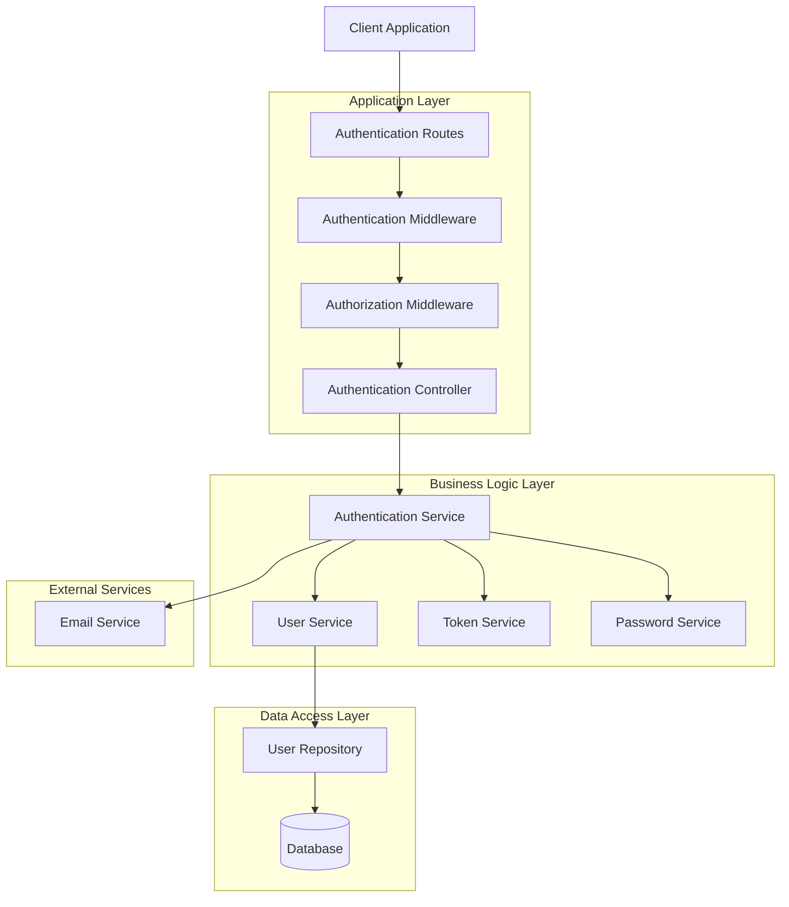
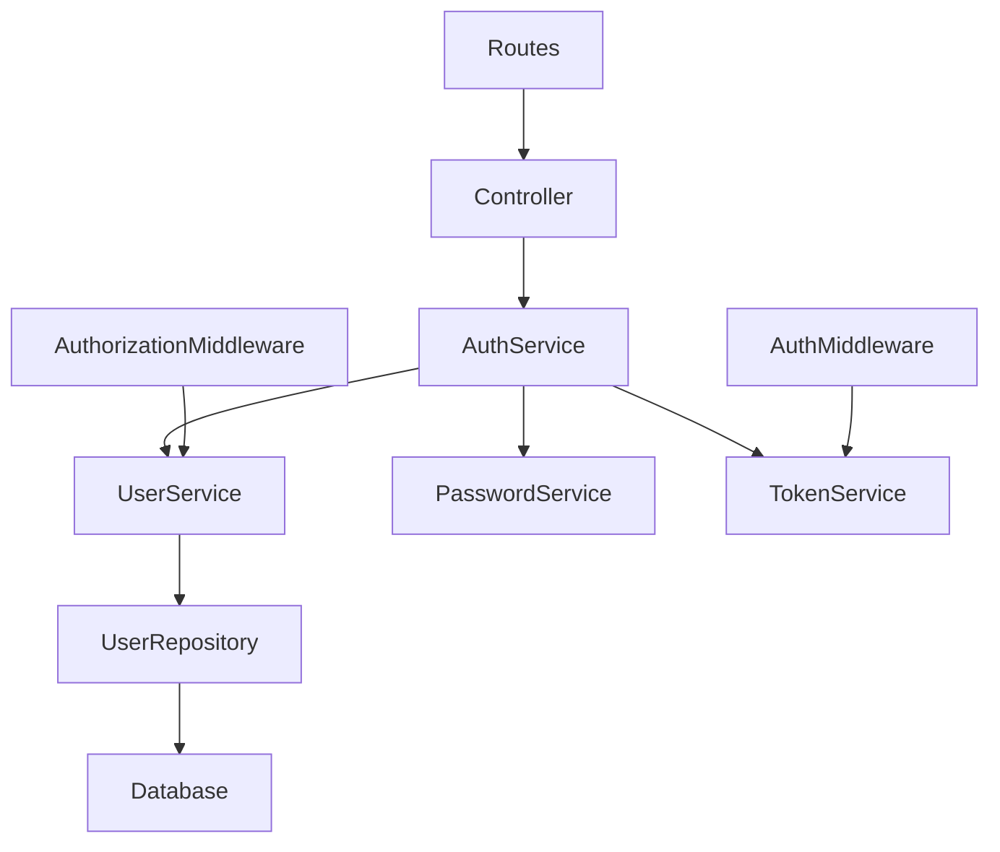
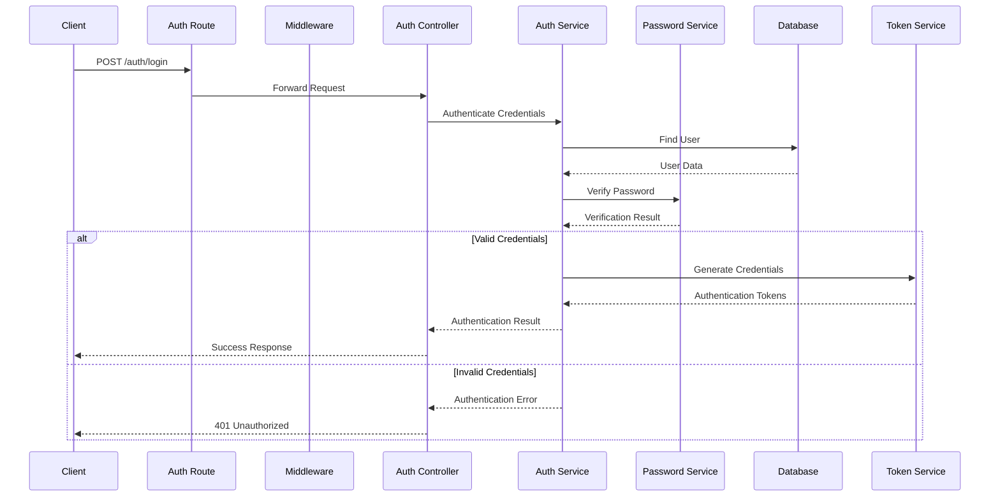
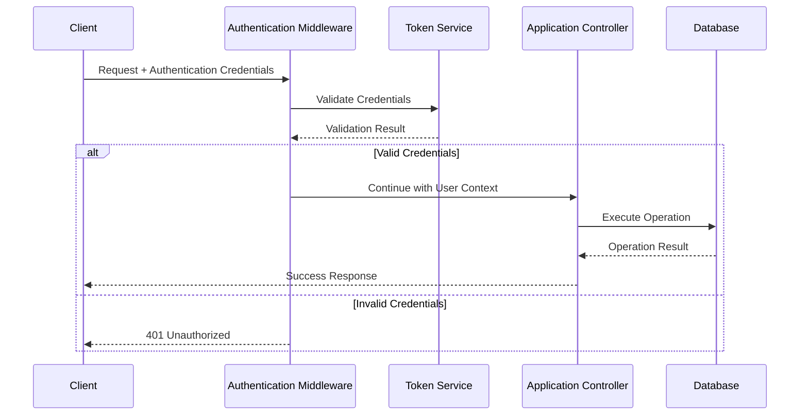

# Authentication System Architecture

## 1. Overview

This document describes the architecture of the application's authentication and authorization system.

The authentication architecture defines how the application manages user identities, verifies credentials, maintains authenticated sessions, and enforces access control.

The system is designed around separation of concerns, modular components, secure communication, and maintainable business logic.

### Architectural Objectives

- Provide secure user authentication.
- Separate authentication and authorization responsibilities.
- Centralize credential validation and token management.
- Protect application resources from unauthorized access.
- Maintain clear separation between controllers, services, and data access.
- Support scalable and maintainable authentication workflows.
- Minimize direct dependencies between application components.

---

## 2. High-Level Architecture

The authentication system consists of several logical layers.



_Note: This is a conceptual architecture. Adapt the components and connections to your actual implementation._

---

## 3. Architectural Layers

### 3.1 Presentation Layer

Responsible for receiving and processing incoming authentication requests.

Components:

- Authentication routes.
- Authentication controllers.
- Request validation.
- Response formatting.

Responsibilities:

- Expose authentication endpoints.
- Validate incoming request structures.
- Forward requests to business services.
- Return appropriate HTTP responses.
- Handle request-level errors.

The presentation layer should not contain complex authentication business logic.

### 3.2 Middleware Layer

Responsible for processing requests before they reach application controllers.

Components:

- Authentication middleware.
- Authorization middleware.
- Request validation middleware.
- Rate-limiting middleware.

Responsibilities:

- Extract authentication credentials.
- Validate access tokens or sessions.
- Identify the current user.
- Enforce role and permission requirements.
- Reject unauthorized requests.

### 3.3 Business Logic Layer

Contains the core authentication and account-management logic.

Components:

**Authentication Service**

- Handles user login.
- Coordinates credential verification.
- Manages authentication operations.
- Coordinates token or session creation.

**User Service**

- Handles user registration.
- Manages account information.
- Handles account status and verification.

**Token Service**

- Generates authentication tokens.
- Validates tokens.
- Handles expiration and refresh operations.
- Supports token revocation when implemented.

**Password Service**

- Hashes passwords.
- Verifies submitted passwords.
- Applies password validation policies.
- Supports password updates and recovery.

### 3.4 Data Access Layer

Responsible for communication with persistent storage.

Components:

- User repository.
- Session repository, if applicable.
- Token repository, if applicable.
- Database models.

Responsibilities:

- Retrieve user records.
- Create and update user accounts.
- Retrieve authentication-related data.
- Persist session and token information where required.
- Abstract database operations from business logic.

### 3.5 External Integration Layer

Provides communication with external services.

Potential integrations:

- Email delivery provider.
- SMS provider.
- Multi-factor authentication provider.
- Identity provider.
- External OAuth providers.

Responsibilities:

- Deliver verification emails.
- Send password recovery links.
- Support external identity verification.
- Handle integration errors.

Only include integrations that are actually implemented.

---

## 4. Core Components

| Component                 | Main Responsibility                   |
| ------------------------- | ------------------------------------- |
| Authentication Routes     | Define authentication endpoints       |
| Authentication Controller | Handle HTTP requests and responses    |
| Authentication Service    | Coordinate authentication operations  |
| User Service              | Manage user accounts                  |
| User Repository           | Handle user persistence               |
| Password Service          | Hash and verify passwords             |
| Token Service             | Generate and validate tokens          |
| Authentication Middleware | Verify user identity                  |
| Authorization Middleware  | Enforce access permissions            |
| Email Service             | Send verification and recovery emails |

---

## 5. Component Dependency Architecture

The system should follow a controlled dependency structure.



### Dependency Rules

1. Controllers depend on application services.
2. Services contain business rules.
3. Repositories encapsulate database operations.
4. Password operations are handled by a dedicated component.
5. Token operations are handled by a dedicated component.
6. Middleware should delegate complex operations to services.
7. Database implementation details should not leak into controllers.
8. Components should depend on abstractions where practical.

---

## 6. Authentication Data Flow

### 6.1 Login Data Flow



### 6.2 Protected Request Data Flow



---

## 7. Database Architecture

The database stores the information required to manage user identities and authentication state.

### Potential Entities

#### User

| Field             | Description                  |
| ----------------- | ---------------------------- |
| id                | Unique user identifier       |
| email             | User email address           |
| password_hash     | Hashed password              |
| status            | Account status               |
| email_verified_at | Email verification timestamp |
| created_at        | Account creation timestamp   |
| updated_at        | Last update timestamp        |

#### Session

Applicable when the system uses server-managed sessions.

| Field      | Description                  |
| ---------- | ---------------------------- |
| id         | Session identifier           |
| user_id    | Associated user              |
| expires_at | Session expiration           |
| created_at | Session creation timestamp   |
| revoked_at | Session revocation timestamp |

#### Refresh Token

Applicable when refresh-token authentication is implemented.

| Field      | Description                |
| ---------- | -------------------------- |
| id         | Token record identifier    |
| user_id    | Associated user            |
| token_hash | Hashed token value         |
| expires_at | Token expiration           |
| revoked_at | Token revocation timestamp |
| created_at | Token creation timestamp   |

#### Password Reset Token

| Field      | Description                 |
| ---------- | --------------------------- |
| id         | Recovery record identifier  |
| user_id    | Associated user             |
| token_hash | Hashed recovery token       |
| expires_at | Token expiration            |
| used_at    | Token consumption timestamp |

_Note: These are conceptual entities. The actual schema depends on the authentication strategy and database implementation._

---

## 8. Authentication and Authorization Architecture

Authentication and authorization are separate architectural responsibilities.

### Authentication

Responsible for establishing user identity.

Supported mechanisms may include:

- Username and password.
- Email and password.
- Access tokens.
- Server-side sessions.
- OAuth 2.0 / OpenID Connect.
- Multi-factor authentication.

### Authorization

Responsible for controlling access to application resources.

Potential authorization models:

**Role-Based Access Control (RBAC)**

Permissions are assigned to roles, and users receive permissions through their assigned roles.

Example:

| Role    | Permissions                           |
| ------- | ------------------------------------- |
| Admin   | Manage users and application settings |
| Manager | Manage assigned resources             |
| User    | Access personal resources             |
| Guest   | Access public resources               |

**Permission-Based Access Control**

Individual permissions determine whether a user can perform a specific operation.

Example:

- `users.read`
- `users.create`
- `users.update`
- `users.delete`
- `profile.read`
- `profile.update`

---

## 9. Security Architecture

Security must be considered across every authentication component.

### Password Security

- Use Argon2id or bcrypt for password hashing.
- Never store plaintext passwords.
- Never log passwords.
- Apply appropriate password policies.
- Verify passwords using secure library functions.

### Token Security

- Sign tokens using secure cryptographic algorithms.
- Validate token signatures and expiration.
- Store signing keys outside source control.
- Apply refresh-token rotation where supported.
- Support revocation where required.
- Avoid exposing credentials in URLs or logs.

### Session Security

When cookie-based sessions are used:

- Set the HttpOnly attribute.
- Set the Secure attribute in production.
- Configure SameSite appropriately.
- Use session expiration.
- Rotate session identifiers after authentication.
- Protect state-changing requests against CSRF.

### API Security

- Enforce HTTPS.
- Apply rate limiting.
- Validate all incoming data.
- Avoid revealing sensitive account information.
- Apply authorization checks to protected resources.
- Use consistent error handling.

---

## 10. Error Handling Architecture

Errors should be handled consistently across the authentication system.

| Error Type               | HTTP Status |
| ------------------------ | ----------- |
| Invalid credentials      | 401         |
| Missing credentials      | 401         |
| Invalid or expired token | 401         |
| Insufficient permissions | 403         |
| Duplicate account        | 409         |
| Invalid request          | 400         |
| Rate limit exceeded      | 429         |
| Internal server error    | 500         |

### Error Handling Principles

1. Authentication services should return or raise well-defined errors.
2. Controllers should translate application errors into HTTP responses.
3. Middleware should reject invalid requests consistently.
4. Sensitive internal details should never be exposed to clients.
5. Unexpected errors should be logged safely.
6. Error responses should follow a consistent structure.

---

## 11. Configuration and Environment Variables

Sensitive authentication configuration should be managed through environment variables or a dedicated secrets-management system.

Example:

```env
APP_ENV=production

DATABASE_URL=

JWT_SECRET=
JWT_ACCESS_TOKEN_EXPIRES_IN=
JWT_REFRESH_TOKEN_EXPIRES_IN=

PASSWORD_HASHING_ALGORITHM=

EMAIL_HOST=
EMAIL_PORT=
EMAIL_USERNAME=
EMAIL_PASSWORD=
```

### Configuration Guidelines

- Never commit production secrets to source control.
- Use different credentials for development, testing, and production.
- Validate required configuration during application startup.
- Rotate secrets when necessary.
- Restrict access to sensitive configuration.

---

## 12. Scalability and Maintainability

The authentication architecture should support future changes without requiring major modifications to unrelated application components.

Recommended practices:

- Keep authentication logic modular.
- Separate authentication from authorization.
- Use repository abstractions where appropriate.
- Centralize token validation.
- Avoid duplicating password verification logic.
- Use automated tests for security-sensitive components.
- Keep external integrations isolated.
- Use dependency injection where supported.
- Make session and token expiration configurable.

### Potential Future Extensions

- Multi-factor authentication (MFA).
- OAuth 2.0 and OpenID Connect.
- Social login.
- Single Sign-On (SSO).
- Device and session management.
- Audit logging.
- Account lockout policies.
- Risk-based authentication.

---

## 13. Testing Architecture

Testing should cover each architectural layer independently and verify the complete authentication flow.

| Layer            | Testing Focus                     |
| ---------------- | --------------------------------- |
| Controllers      | HTTP requests and responses       |
| Services         | Authentication business logic     |
| Repositories     | Database operations               |
| Password Service | Hashing and password verification |
| Token Service    | Token generation and validation   |
| Middleware       | Authentication enforcement        |
| Authorization    | Role and permission checks        |
| Integration      | Complete authentication workflows |

### Testing Categories

- Unit testing.
- Integration testing.
- API testing.
- Security testing.
- End-to-end testing.
- Negative and edge-case testing.

---

## 14. Architecture Decision Records

Important architectural decisions should be documented separately using Architecture Decision Records (ADRs).

Examples:

| Decision | Description                            |
| -------- | -------------------------------------- |
| ADR-001  | Selection of authentication strategy   |
| ADR-002  | Password hashing algorithm             |
| ADR-003  | Access and refresh token strategy      |
| ADR-004  | Session management approach            |
| ADR-005  | Authorization model                    |
| ADR-006  | External identity provider integration |

Each ADR should explain:

- Context.
- Problem.
- Decision.
- Alternatives considered.
- Consequences.

---

## 15. Related Documentation

For additional implementation details, refer to:

| Document           | Purpose                                    |
| ------------------ | ------------------------------------------ |
| `workflows.md`     | Authentication and authorization workflows |
| `api-reference.md` | Authentication API endpoints               |
| `database.md`      | Database entities and relationships        |
| `security.md`      | Security policies and implementation       |
| `testing.md`       | Testing strategy and test scenarios        |
| `deployment.md`    | Deployment and configuration instructions  |

---

## 16. Source Code Mapping

The following structure is an example of how architecture components may map to source code.

```text
src/
├── routes/
│   └── auth/
├── controllers/
│   └── auth/
├── services/
│   ├── auth/
│   ├── token/
│   └── user/
├── middleware/
│   ├── authentication/
│   └── authorization/
├── repositories/
│   └── user/
├── models/
│   └── user/
├── utils/
│   └── password/
└── config/
    └── auth/
```

Replace these paths with the actual directories and files in the project.

---

## 17. Architecture Summary

The authentication architecture separates application responsibilities into distinct layers:

1. **Presentation:** Handles incoming requests and responses.
2. **Middleware:** Validates authentication and authorization.
3. **Business Logic:** Implements authentication and account-management rules.
4. **Data Access:** Manages persistent user and authentication data.
5. **External Integrations:** Communicates with third-party services.

This separation improves maintainability, testability, security, and extensibility.

**Document Type:** Technical Architecture Documentation

**System:** Authentication and Authorization

**Status:** Initial Template

**Document Owner:** Development Team
