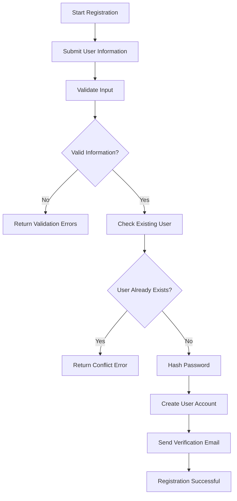
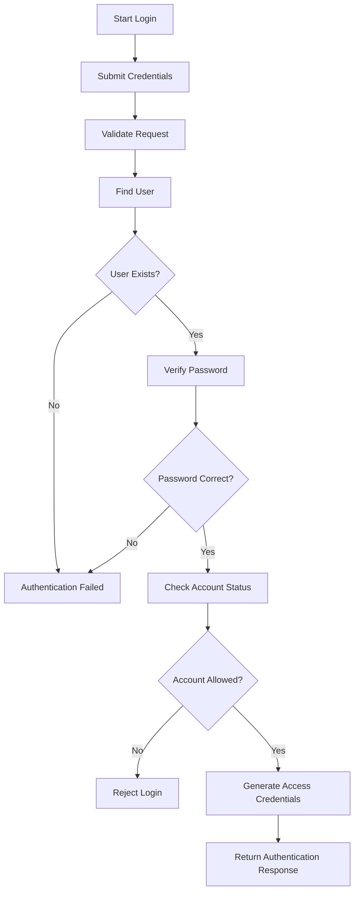
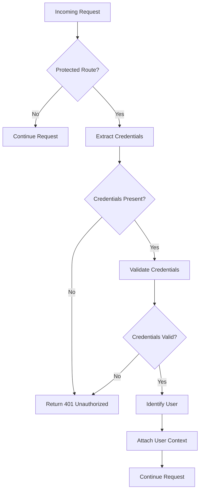
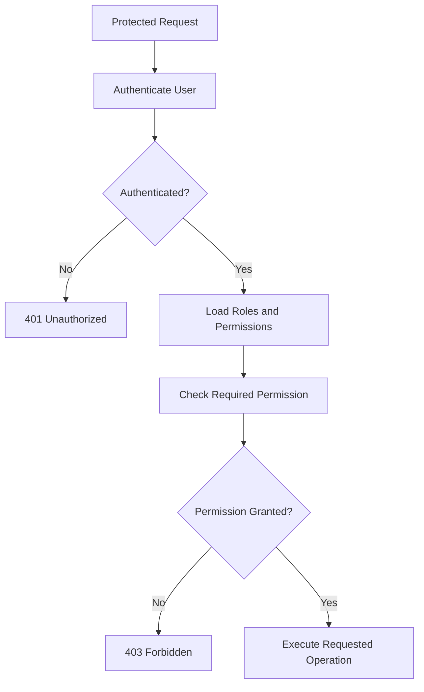
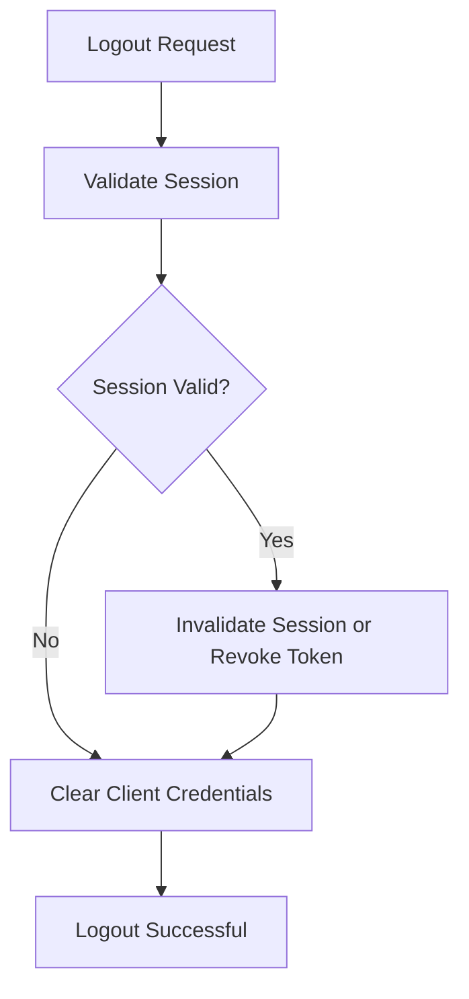
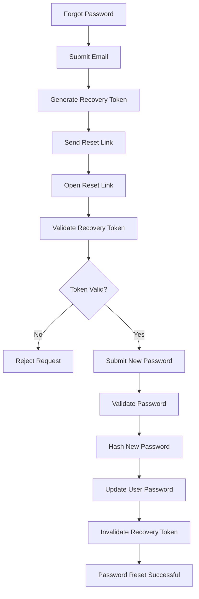
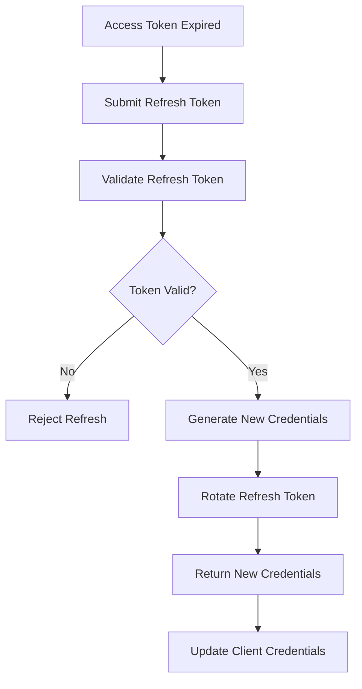

# Authentication Workflows

## 1. Overview

This document describes the authentication and authorization workflows implemented in the application.

The authentication system is responsible for verifying user identities, managing authenticated sessions, and controlling access to protected resources.

### Objectives

- Authenticate users securely.
- Manage user sessions and authentication tokens.
- Protect private application resources.
- Support account registration and login.
- Provide password recovery functionality.
- Enforce authorization rules and access permissions.

---

## 2. Authentication Architecture

The authentication process generally involves the following components:

| Component                 | Responsibility                                 |
| ------------------------- | ---------------------------------------------- |
| Client                    | Sends authentication requests.                 |
| Authentication Controller | Handles authentication endpoints.              |
| Authentication Service    | Implements authentication business logic.      |
| User Repository           | Retrieves and updates user information.        |
| Database                  | Stores user accounts and authentication data.  |
| Password Hasher           | Hashes and verifies passwords.                 |
| Token Service             | Generates and validates authentication tokens. |
| Authentication Middleware | Validates authentication credentials.          |
| Authorization Middleware  | Checks user permissions and roles.             |

---

## 3. User Registration Workflow

### Description

This workflow describes how a new user creates an account.

### Process

1. The client submits registration information.
2. The application validates the submitted data.
3. The system checks whether the email or username already exists.
4. The password is securely hashed.
5. A new user record is created in the database.
6. The system optionally generates an email verification token.
7. The user receives a registration confirmation.

### Workflow Diagram

### Expected Results

- A valid user account is created.
- Passwords are never stored in plaintext.
- Duplicate accounts are rejected.
- Invalid registration data produces appropriate errors.

---

## 4. User Login Workflow

### Description

This workflow describes how an existing user authenticates with the application.

### Process

1. The client submits login credentials.
2. The application validates the request.
3. The system retrieves the user account.
4. The submitted password is compared with the stored password hash.
5. The system checks whether the account is active and permitted to log in.
6. Authentication credentials are generated.
7. The client receives the authentication response.

### Workflow Diagram

### Expected Results

- Valid credentials authenticate the user.
- Invalid credentials are rejected.
- Inactive or blocked accounts cannot authenticate.
- Authentication tokens are generated securely.

---

## 5. Authentication Middleware Workflow

### Description

Authentication middleware protects application routes by validating the credentials included in incoming requests.

### Process

1. The client sends a request to a protected endpoint.
2. The middleware extracts the authentication credentials.
3. The token or session is validated.
4. The system verifies expiration and validity.
5. The authenticated user is identified.
6. The user context is attached to the request.
7. The request continues to the next middleware or controller.

### Workflow Diagram

### Expected Results

- Requests without valid credentials are rejected.
- Expired or invalid tokens cannot access protected resources.
- Authenticated user information is available to downstream components.

---

## 6. Authorization Workflow

### Description

Authorization determines whether an authenticated user has permission to perform a specific operation.

Authentication answers: Who are you?

Authorization answers: What are you allowed to do?

### Process

1. The user submits a request.
2. Authentication middleware validates the user's identity.
3. Authorization middleware retrieves the user's roles or permissions.
4. The required permission is evaluated.
5. Access is granted or denied.

### Workflow Diagram

### Expected Results

- Users can only access resources they are authorized to use.
- Unauthorized operations return an appropriate error.
- Role and permission checks are enforced consistently.

---

## 7. User Logout Workflow

### Description

This workflow describes how a user terminates an authenticated session.

### Process

1. The client submits a logout request.
2. The application validates the current session or token.
3. The server invalidates the session or revokes the relevant token, if supported.
4. The client removes locally stored authentication credentials.
5. The application confirms logout.

### Workflow Diagram

### Expected Results

- The user session is terminated.
- Revoked credentials cannot be reused.
- Client-side authentication data is cleared.

---

## 8. Password Recovery Workflow

### Description

This workflow allows users to recover access to their accounts when they forget their passwords.

### Process

1. The user submits a password recovery request.
2. The system checks the submitted email address.
3. A secure, time-limited recovery token is generated.
4. A password reset link is sent to the user's email.
5. The user opens the recovery link.
6. The system validates the recovery token.
7. The user submits a new password.
8. The new password is validated and securely hashed.
9. The password is updated in the database.
10. The recovery token is invalidated.

### Workflow Diagram

### Expected Results

- Recovery tokens are unique and time-limited.
- Invalid or expired tokens are rejected.
- Passwords are securely hashed.
- Recovery tokens cannot be reused.

---

## 9. Token Refresh Workflow

### Description

If the application uses access and refresh tokens, this workflow describes how users obtain new access tokens without repeating the login process.

### Process

1. The client detects an expired or expiring access token.
2. The client submits a refresh token.
3. The server validates the refresh token.
4. The server checks whether the refresh token has been revoked or expired.
5. New authentication credentials are generated.
6. The server returns the new credentials.
7. The client updates its stored credentials.

### Workflow Diagram

### Expected Results

- Valid refresh tokens can obtain new credentials.
- Expired or revoked refresh tokens are rejected.
- Refresh token rotation is performed when supported.

---

## 10. Account Verification Workflow

### Description

This workflow verifies that a user owns the email address associated with their account.

### Process

1. The user registers an account.
2. The system generates an email verification token.
3. A verification link is sent to the user's email.
4. The user opens the verification link.
5. The system validates the token.
6. The account verification status is updated.
7. The user receives confirmation.

### Expected Results

- Email ownership is verified.
- Expired and invalid verification tokens are rejected.
- Already-used verification tokens cannot be reused.

---

## 11. Authentication Error Handling

The application should handle authentication errors consistently.

| Scenario                           | Expected HTTP Status      |
| ---------------------------------- | ------------------------- |
| Invalid credentials                | 401 Unauthorized          |
| Missing authentication credentials | 401 Unauthorized          |
| Expired access token               | 401 Unauthorized          |
| Insufficient permissions           | 403 Forbidden             |
| Duplicate registration             | 409 Conflict              |
| Invalid request data               | 400 Bad Request           |
| Too many login attempts            | 429 Too Many Requests     |
| Unexpected server error            | 500 Internal Server Error |

Error messages should avoid exposing sensitive information about user accounts, passwords, tokens, or internal implementation details.

---

## 12. Security Considerations

The authentication system should follow these security practices:

- Store passwords using a secure password hashing algorithm such as Argon2id or bcrypt.
- Never store plaintext passwords.
- Use HTTPS for authentication requests.
- Apply rate limiting to login and password recovery endpoints.
- Use secure, HttpOnly, and appropriate SameSite cookie settings when using cookie-based sessions.
- Validate token signatures, expiration, and relevant claims.
- Protect against brute-force attacks.
- Prevent token reuse where token revocation or rotation is supported.
- Avoid logging passwords, access tokens, or refresh tokens.
- Apply authorization checks to all protected operations.
- Use generic login and password recovery responses where appropriate.
- Invalidate existing sessions after sensitive account changes when required.

---

## 13. Related Source Code

The following source code locations should be documented and linked to their actual implementation.

| Component                 | Source Code Location           |
| ------------------------- | ------------------------------ |
| Authentication Routes     | `src/routes/auth`              |
| Authentication Controller | `src/controllers/auth`         |
| Authentication Service    | `src/services/auth`            |
| User Repository           | `src/repositories/user`        |
| User Model                | `src/models/user`              |
| Authentication Middleware | `src/middleware/auth`          |
| Authorization Middleware  | `src/middleware/authorization` |
| Token Service             | `src/services/token`           |
| Password Utilities        | `src/utils/password`           |
| Authentication Tests      | `tests/auth`                   |

_Note: These are example paths. Replace them with the actual paths in your project._

---

## 14. Testing Scenarios

The following scenarios should be covered by automated tests.

| Workflow           | Test Scenario                                     |
| ------------------ | ------------------------------------------------- |
| Registration       | Register with valid information                   |
| Registration       | Register with an existing email                   |
| Login              | Login with valid credentials                      |
| Login              | Login with an incorrect password                  |
| Login              | Login with a disabled account                     |
| Authentication     | Access a protected endpoint without credentials   |
| Authentication     | Access a protected endpoint with an expired token |
| Authorization      | Access a resource without sufficient permissions  |
| Logout             | Logout from an active session                     |
| Password Recovery  | Request a password reset                          |
| Password Recovery  | Use an expired recovery token                     |
| Password Recovery  | Reset a password successfully                     |
| Token Refresh      | Refresh using a valid refresh token               |
| Token Refresh      | Refresh using a revoked refresh token             |
| Email Verification | Verify an account using a valid token             |

---

## 15. Maintenance Notes

Whenever the authentication implementation changes, update this document accordingly.

Changes that require documentation updates include:

- New authentication endpoints.
- Changes to login or registration logic.
- Changes to token generation or validation.
- Changes to session management.
- New roles or permissions.
- Password policy changes.
- New account verification mechanisms.
- Changes to authentication middleware.
- Security-related modifications.

**Document owner:** Development Team

**Document type:** Technical Workflow Documentation

**Status:** Initial Template
